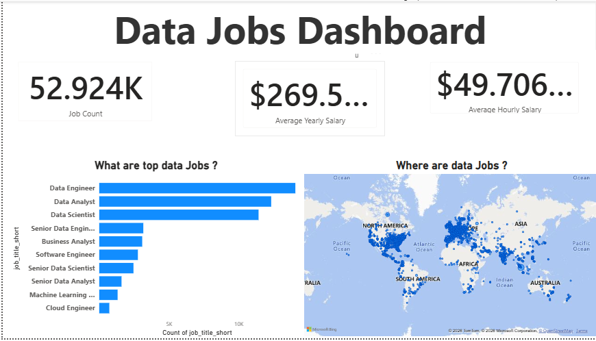

# Data Jobs Dashboard 📊

## Project Overview
This project is a Power BI dashboard created to explore job-posting data, salary metrics, popular data-related job titles, and geographic job locations.

The project uses a **synthetic practice dataset created with the help of ChatGPT** for learning and portfolio practice. The figures should not be interpreted as verified real-world job-market statistics.

## Dashboard Preview

## Project Objectives
- Explore the distribution of data-related job titles.
- Display job-record counts using KPI cards.
- Summarize yearly and hourly salary metrics.
- Visualize job locations on a world map.
- Practice data visualization and dashboard design with Power BI.

## Tools and Technologies
- Microsoft Power BI Desktop
- Microsoft Excel
- GitHub

## Key Dashboard Components
- **Job Count:** Displays the count of job-title records included in the report.
- **Average Yearly Salary:** Summarizes yearly salary values.
- **Average Hourly Salary:** Summarizes hourly salary values.
- **Top 10 Data Jobs:** A bar chart comparing the most frequent job titles.
- **Geographic Distribution:** A map showing job locations.

## Dataset
The dataset is a synthetic practice dataset prepared for learning purposes. It is organized into monthly data queries.

The results depend on the sample data and report calculations. They do not establish actual job-market demand or verified salary benchmarks.

## How to View the Project
1. Open the dashboard preview image above.
2. To explore the interactive report, download the `.pbix` file from this repository if it is provided.
3. Open the file using Microsoft Power BI Desktop.

## Limitations
- The dataset is intended for practice, not real-world market analysis.
- Salary metrics depend on the available sample records and the report's aggregation settings.
- Geographic results depend on the location values in the dataset and how Power BI maps them.

## Future Improvements
- Validate all KPI calculations and data types.
- Improve chart labels and formatting.
- Add filters for job titles, locations, and salary ranges.
- Document data preparation and measures after verification.

## Author
**Guddu Kumar**

Created as a learning project to practice Power BI and data analytics.
